# Pronóstico del almacenamiento total de agua

## Resultados del Proyecto 2

**Random Forest, XGBoost y redes neuronales LSTM**

Universidad del Valle de Guatemala

Facultad de Ingeniería

Departamento de Ciencias de la Computación

CC3084 Data Science · Semestre II de 2026

**Integrantes**

Javier Valladares · 23045

Ian Cumes · 23236

Javier Cifuentes · 23079

13 de octubre de 2026

Reto: *A Step Ahead of Drought: Forecasting Global Water Storage Challenge by ITU*

[Repositorio del proyecto](https://github.com/Javiervalladares1/CC3084-Proyecto2-Drought-EDA)

<!-- pagebreak -->

# Resumen de resultados

Se construyeron y ejecutaron tres familias de regresión para pronosticar el almacenamiento total de agua del siguiente mes calendario: Random Forest, XGBoost y LSTM. El conjunto contiene 2,154,021 observaciones con etiquetas y 15,715 celdas terrestres. La comparación usó una ventana causal de seis meses, la misma información para todos los modelos y faltantes de TWS por bloques temporales.

Se compararon tres configuraciones manuales por algoritmo. Los parámetros se ajustaron con objetivos de 2011-2012, la selección entre familias se fijó en 2013 y la prueba final reservada comprendió 265,447 observaciones de 17 meses observados entre enero de 2014 y septiembre de 2015. La separación se definió por fecha del objetivo y se excluyeron las etiquetas de la construcción de entradas.

La selección previa a la prueba final fue XGBoost. En la prueba reservada obtuvo RMSE de 0.7035, MAE de 0.5208 y R² de 0.3088. Su variación de RMSE frente a persistencia causal equivale a una mejora de 17.10 %. El menor RMSE final observado entre las tres familias correspondió a LSTM; esta comparación se informa sin volver a ajustar los modelos con la prueba.

La aplicación permite explorar patrones temporales y geográficos, ingresar una observación o un CSV, seleccionar uno o los tres algoritmos y mostrar u ocultar el rendimiento. Para pronósticos nuevos utiliza modelos reajustados con todas las etiquetas de entrenamiento; las métricas que muestra provienen de modelos distintos que conservaron intacta la prueba temporal.

Las predicciones conservan la escala estandarizada del reto. Test.csv carece de etiquetas: se entregan sus pronósticos, pero no se atribuye a ese archivo un RMSE conocido. La evaluación se refiere a futuras fechas en ubicaciones observadas y no demuestra transferencia a regiones completamente nuevas.

**Palabras clave:** GRACE, almacenamiento total de agua, pronóstico, Random Forest, XGBoost, LSTM, validación temporal.

<!-- pagebreak -->

# 1 Introducción y objetivos

Los productos GRACE integran información sobre cambios en el agua almacenada sobre y bajo la superficie terrestre. Su latencia limita el monitoreo próximo al tiempo real. El reto de Zindi e ITU plantea estimar el TWS del siguiente mes calendario mediante información disponible hasta el mes de emisión. Cuando el TWS contemporáneo está oculto, aumenta la antigüedad de la última observación hidrológica conocida (Zindi, s. f.).

El problema se formula como regresión supervisada: cada fila contiene una celda, un mes y covariables climáticas; target es una cantidad continua. Por ello se evalúan errores de pronóstico y no exactitud de clasificación. La pregunta central es qué familia proporciona la mejor combinación de precisión temporal, desempeño regional y costo computacional bajo la disponibilidad real de información.

## Objetivo general

Construir, comparar e integrar en una aplicación tres algoritmos de aprendizaje automático para pronosticar el almacenamiento total de agua del siguiente mes, mediante un procedimiento reproducible que respete el calendario y evite usar observaciones futuras.

## Objetivos específicos

1. Caracterizar los datos y preparar entradas causales con indicadores de faltantes y memoria hidrológica.

2. Fundamentar en literatura científica la selección de Random Forest, XGBoost y LSTM, y ajustar configuraciones mediante validación temporal.

3. Comparar error, sesgo, eficiencia y estabilidad regional de los modelos en una prueba reservada y frente a referencias simples.

4. Desarrollar una aplicación que permita explorar datos, emitir pronósticos y consultar u ocultar resultados interactivos.

5. Documentar los experimentos, sus limitaciones y los pasos necesarios para reproducir y utilizar la solución.

<!-- pagebreak -->

# 2 Marco teórico del problema

## Almacenamiento total de agua y observación satelital

TWS integra agua superficial, humedad del suelo, agua subterránea y nieve. GRACE y GRACE-FO estiman cambios de masa mediante variaciones del campo gravitatorio. El almacenamiento responde a procesos con distintas velocidades; una lluvia reciente no resume por sí sola la condición de acuíferos o reservas acumuladas (NASA/JPL, s. f.). En los artículos se usa habitualmente TWSA, es decir, anomalías respecto de una referencia.

## SPEI y memoria climática

El SPEI se basa en un balance entre precipitación y demanda evaporativa acumulado a diferentes escalas. Esa característica permite estudiar déficits de corta y larga duración (Vicente-Serrano et al., 2010). Los archivos entregan escalas de 1, 3, 6 y 12 meses, junto con humedad del suelo. Se conservan esas entradas en su escala suministrada; no se imponen categorías físicas de sequía sobre valores transformados sin conocer su correspondencia original.

## Pronóstico y reconstrucción

Reconstruir observaciones pasadas puede utilizar forzantes conocidos retrospectivamente. Pronosticar exige que cada entrada exista al emitir la predicción. Un buen resultado al completar el intervalo entre misiones no equivale automáticamente a precisión operativa hacia el futuro. En este proyecto, t+1 significa el próximo mes calendario y no el siguiente registro disponible. Las ventanas se reindexan para representar explícitamente meses ausentes.

## Dependencia entre observaciones

Las filas comparten fechas, celdas y condiciones regionales. Millones de filas no equivalen a millones de periodos independientes. Mezclar filas aleatoriamente entre entrenamiento y prueba puede favorecer una evaluación excesivamente optimista. La separación temporal y los diagnósticos regionales responden a este problema (Roberts et al., 2017).

<!-- pagebreak -->

# 3 Marco teórico de los algoritmos

## Random Forest

Random Forest agrega árboles entrenados con muestras bootstrap y selección aleatoria de variables. En regresión, el promedio reduce la variabilidad de árboles individuales y representa relaciones no lineales e interacciones (Breiman, 2001). La profundidad y el mínimo de muestras por hoja controlan complejidad. Su predicción depende de patrones observados y tiene capacidad limitada para extrapolar tendencias fuera de los valores aprendidos.

## XGBoost

XGBoost construye árboles de manera secuencial para corregir errores de las predicciones anteriores. La función objetivo combina error de ajuste y penalizaciones de complejidad. La tasa de aprendizaje regula el aporte de cada árbol, mientras subsample y colsample_bytree introducen muestreo de observaciones y variables. El método por histogramas facilita trabajar con matrices extensas. Se utilizó parada temprana en validación para determinar el número de iteraciones (XGBoost Developers, s. f.).

## Redes neuronales LSTM

Una LSTM mantiene un estado de memoria regulado por compuertas, lo que permite aprender dependencias en secuencias (Hochreiter & Schmidhuber, 1997). La implementación utiliza torch.nn.LSTM (PyTorch Contributors, s. f.), recibe seis pasos mensuales en orden cronológico y combina su representación final con información de contexto. Una capa densa produce una corrección continua. La regularización, el recorte de gradiente y la parada temprana ayudan a controlar inestabilidad y sobreajuste.

## Predicción de una corrección

Las tres familias modelan la misma cantidad residual: diferencia entre el objetivo y el último TWS observable. La salida final suma esa observación a la corrección aprendida. Si no hay historia, se usa cero acompañado de un indicador de ausencia. Esta formulación aprovecha la persistencia sin utilizar una etiqueta oculta como entrada. La historia se obtiene únicamente de TWS_t permitido y nunca de target de otra fila.

<!-- pagebreak -->

# 4 Revisión bibliográfica de modelos tabulares

La revisión narrativa dirigida incorporó nueve antecedentes científicos, más dos fundamentos sobre memoria neuronal y SPEI. Se consultaron páginas editoriales, DOI y registros institucionales. Se contrastaron metadatos con Crossref y se distinguieron tareas, escala, entradas y validación. No se presenta como una revisión sistemática ni como una búsqueda realizada dentro de Scopus.

Long et al. (2014) utilizaron redes neuronales artificiales para extender GRACE y estudiar sequías e inundaciones en la meseta Yun-Gui. Reportaron R² de 0.91 para la meseta y valores menores en subregiones. El trabajo respalda relaciones no lineales y evaluación territorial; su reconstrucción histórica no prueba precisión futura en una rejilla global.

Z. Sun et al. (2020) compararon DNN, regresión lineal múltiple y SARIMAX con seis productos GRACE y 60 cuencas. La DNN superó ligeramente a SARIMAX y más claramente al modelo lineal en la mayoría de las cuencas. El desempeño dependió del régimen hidrológico y de la intervención humana. La lección es comparar complejidad y memoria bajo condiciones comunes.

A. Y. Sun et al. (2021) evaluaron familias lineales, Random Forest, GBM, XGBoost y redes profundas para reconstrucción en Estados Unidos. El resumen reporta NSE medio de prueba cercano a 0.85 y RMSE normalizado cercano a 0.09. Ninguna familia dominó en todo el territorio. Su flujo AutoML no se adopta porque las reglas del reto lo prohíben; se utilizan como antecedentes los algoritmos individuales.

Breiman (2001) aporta el fundamento de Random Forest. Su inclusión permite contrastar un promedio de árboles con el ajuste secuencial de XGBoost. Las métricas de los artículos se conservan en sus contextos y no se comparan directamente con el RMSE estandarizado de este proyecto.

<!-- pagebreak -->

# 5 Revisión de arquitecturas neuronales y pronóstico

Lu et al. (2024) compararon LSTM, BiLSTM con atención y retropropagación mejorada en seis regiones de China, con prueba temporal de septiembre de 2019 a mayo de 2023. En dos regiones reportaron RMSE inferior a 2.641 cm y R² de al menos 0.8. Las series estaban completadas previamente y la escala es regional: esos resultados no fijan un error esperado para el reto.

Palazzoli et al. (2025) presentaron GRAiCE, reconstrucciones globales de TWSA de 1984-2021 con LSTM y BiLSTM, con y sin información de vegetación. La correlación de 0.97 destacada para un promedio global incluye entrenamiento y prueba. Es evidencia de reconstrucción a escala agregada, no una precisión independiente por celda.

Mo et al. (2022) propusieron una CNN bayesiana con conexiones residuales y atención para completar el intervalo entre GRACE y GRACE-FO. El uso de estructura espacial e incertidumbre es pertinente, pero requiere convertir las filas en mapas y justificar un costo adicional. Se reserva para una ampliación.

Li y Kusche (2026) abordaron directamente el pronóstico global con resolución de 1° y horizontes de hasta 12 meses. Separaron tendencia y estacionalidad de una componente no estacional modelada con LSTM y predictores rezagados. Evaluaron retrospectivamente 2010-2024 y reportaron mejoras frente a SEAS5 de ECMWF. Es el antecedente más cercano por emisión futura y escala espacial.

La revisión conduce a las tres familias seleccionadas: Random Forest como referencia no lineal tabular, XGBoost por su capacidad de combinar señales e interacciones y LSTM por la memoria temporal. Se conserva una LSTM unidireccional pequeña frente a variantes bidireccionales, atención y convoluciones más complejas. La selección final depende de la evaluación del proyecto.

<!-- pagebreak -->

# 6 Datos originales y auditoría

Train.csv contiene 2,154,021 filas y 13 columnas, con entradas de mayo de 2002 a agosto de 2015. Test.csv contiene 280,961 filas y 13 columnas, correspondientes a 18 meses observados entre septiembre de 2015 y diciembre de 2018. El entrenamiento cubre 138 de 160 meses calendario y presenta 22 huecos estructurales.

| Grupo | Variables | Tratamiento |
| --- | --- | --- |
| Identificación | sample_id / ID | Trazabilidad; se excluyen de los predictores |
| Fecha y espacio | time, lat, lon | Calendario, celda y contexto geográfico |
| Estado hídrico | TWS_t | Disponible u oculto; nunca se rellena con target |
| Clima | SPEI_01_t, SPEI_03_t, SPEI_06_t, SPEI_12_t | Cinco covariables al incluir humedad del suelo |
| Suelo | SOIL_MOISTURE_t | Entrada contemporánea y secuencia histórica |
| Estacionalidad | month_sin, month_cos | Se recalculan desde el mes para nuevas entradas |
| Objetivo | target | Etiqueta continua del mes calendario siguiente |
| Disponibilidad | TWS_t_masked en Test | Los valores True se mantienen como ausentes |

No se detectaron duplicados de identificador ni de celda-mes. El entrenamiento no presenta nulos en las columnas originales. Test contiene 186,913 TWS ocultos, equivalentes a 66.53%; coinciden exactamente con el indicador de enmascaramiento. Las otras covariables están completas.

Se verificó el significado de target enlazándolo con el TWS del siguiente mes cuando ambos registros existen: 1,977,398 correspondencias, con diferencia absoluta máxima de 0. Esta comprobación se utilizó para auditar el objetivo y no para reconstruir predictores.

<!-- pagebreak -->

# 7 Análisis exploratorio temporal

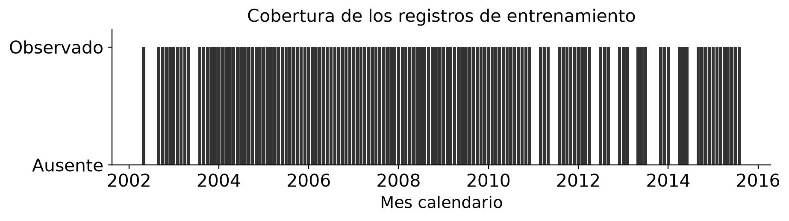

La ausencia de filas en algunos meses exige distinguir un calendario incompleto de una columna con nulos. Desplazar una fila por celda puede saltar varios meses. Por ello cada rezago representa un mes calendario exacto y conserva un indicador cuando ese registro no existe.

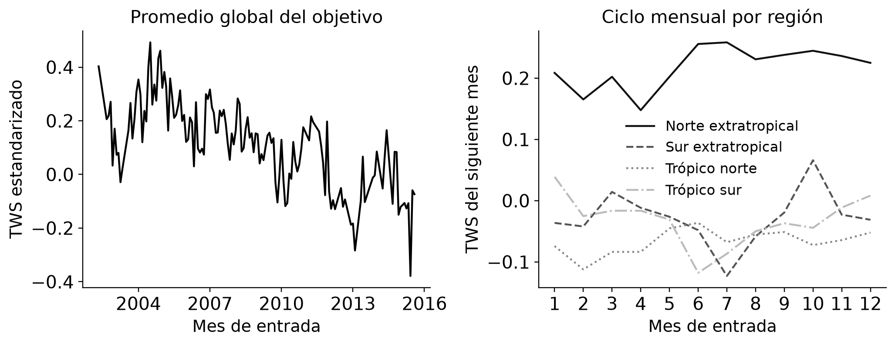

El promedio global combina regiones con ciclos distintos. Los perfiles regionales muestran por qué una señal estacional puede reducirse al agregar hemisferios. Se incorporó la codificación cíclica del mes y se evaluó el error por región, sin asumir que una media global represente la precisión en cada celda.

<!-- pagebreak -->

# 8 Análisis exploratorio espacial y calidad

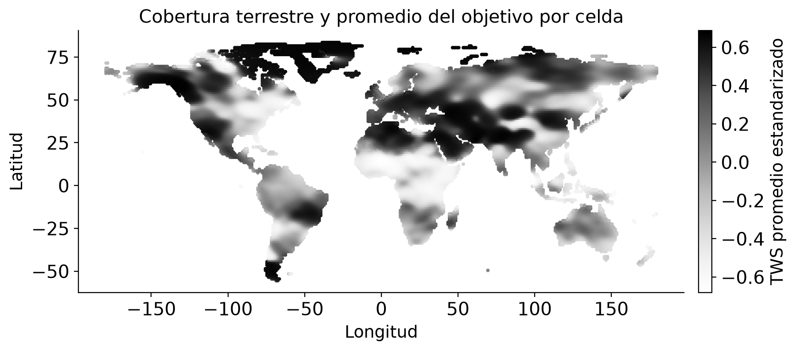

La rejilla contiene 15,715 celdas. El hemisferio norte reúne el 80.31% de las filas, de modo que el error agrupado tiene mayor representación de esas ubicaciones. La evaluación regional complementa el criterio global del reto.

El análisis previo encontró persistencia entre TWS actual y objetivo, junto con asociaciones relevantes de las escalas largas de SPEI. La correlación descriptiva no demuestra causalidad ni establece por sí sola qué algoritmo será mejor. El RMSE previo de persistencia de 0.5724 corresponde a entrenamiento con TWS observable; se recalcularon referencias bajo las nuevas máscaras y fechas para obtener comparaciones válidas.

Se conservaron los valores extremos porque pueden representar condiciones hidrológicas importantes. No se eliminaron observaciones por reglas IQR automáticas. El código valida fechas, rangos geográficos, duplicados, números finitos y covariables necesarias; los errores de entrada se informan antes de predecir. Los archivos crudos permanecen sin modificaciones.

La amplitud temporal y la cobertura espacial difieren entre Train y Test. En particular, Test tiene muchas fechas ausentes. Los indicadores de registro permiten representar ese caso, pero la evaluación histórica no elimina por completo el riesgo de cambio de distribución en años posteriores.

<!-- pagebreak -->

# 9 Preparación causal de las entradas

Se construyó una ventana de seis meses que termina en la fecha de emisión. Cada paso contiene los cuatro SPEI, humedad del suelo, TWS observable y dos indicadores: disponibilidad de TWS y existencia de registro. Los huecos del calendario y el enmascaramiento deliberado quedan diferenciados. Los valores ausentes se representan con cero y sus indicadores; ese cero no se interpreta como una observación de agua.

| Componente | Cantidad | Información |
| --- | --- | --- |
| Secuencia mensual | 6 pasos × 8 canales = 48 | Covariables, TWS e indicadores de disponibilidad |
| Estacionalidad | 2 | Seno y coseno del mes |
| Último TWS e historia | 3 | Valor conocido, antigüedad e indicador de historia |
| Ubicación | 3 | Latitud normalizada y seno/coseno de longitud |
| Tiempo transcurrido | 1 | Meses desde mayo de 2002 divididos entre 120 |
| Total | 57 | Misma información para las tres familias |

Los árboles reciben la ventana aplanada; la LSTM recibe los mismos 48 valores como seis pasos y agrega las nueve variables de contexto a su representación final. El uso de coordenadas permite describir heterogeneidad en la rejilla conocida. No se utilizaron ID ni códigos de celda como predictores, y no se afirma generalización a celdas geográficas no observadas.

La antigüedad de TWS se calcula en meses calendario y se limita a 24 solo en su representación numérica de entrada. La antigüedad real se conserva para diagnóstico. No se interpolan datos futuros ni se reconstruye TWS_t mediante target(t-1). El escalador de la LSTM se ajusta únicamente con las entradas de entrenamiento de cada etapa.

La prueba unitaria cambia valores futuros y etiquetas y comprueba que las entradas pasadas permanezcan idénticas. Otras pruebas verifican calendarios con huecos, máscaras explícitas, orden de filas y equivalencia entre preparación individual y por lotes.

<!-- pagebreak -->

# 10 Diseño de validación y enmascaramiento

Las particiones se definieron antes del ajuste según target_time = time + un mes. Así, la última etiqueta de entrenamiento precede a la primera etiqueta de evaluación. La parada temprana de XGBoost y LSTM se aplicó únicamente a validación de ajuste; la prueba final no se pasó a fit_model ni a una selección posterior de parámetros.

| Etapa | Entrenamiento | Evaluación | Filas evaluadas |
| --- | --- | --- | --- |
| Ajuste | Hasta 2010-12 | 2011-01 a 2012-10, meses presentes | 249,667 |
| Confirmación | Hasta 2012-10 | 2013-01 a 2013-12, meses presentes | 109,287 |
| Prueba reservada | Hasta 2013-12 | 2014-01 a 2015-09, meses presentes | 265,447 |
| Producción | Todo Train.csv | Test.csv, sin etiquetas | 280,961 |

El enmascaramiento sintético usa una semilla independiente y bloques mensuales comunes entre celdas, con escasas excepciones de disponibilidad individual. Oculta el 67.21% del TWS en el conjunto preparado. Las proporciones son 62.32% en validación de ajuste, 71.25% en confirmación y 70.40% en prueba reservada. Las variaciones reflejan los bloques y los huecos de cada periodo; no se presenta una coincidencia exacta con el 66.53% de Test.

Los modelos comparten las mismas filas y máscaras. La última observación conocida se obtiene únicamente de TWS permitido hasta la fecha. Para inferir Test se utiliza la historia observable de Train junto con las entradas de Test disponibles hasta cada emisión. Las etiquetas de validación y prueba nunca se usan para llenar historia.

La recomendación se fijó con el menor RMSE de confirmación de 2013 y se registró junto con una huella de la configuración antes de abrir la prueba final. La prueba temporal mide nuevas fechas en celdas ya conocidas; constituye una evaluación diferente de reservar ubicaciones completas (Roberts et al., 2017).

<!-- pagebreak -->

# 11 Métricas y referencias de comparación

La métrica principal es RMSE: raíz del promedio del error al cuadrado. Se calcula sobre todas las filas evaluadas en la escala del objetivo. Penaliza con mayor intensidad errores grandes. MAE resume el error absoluto medio; R² compara con la variabilidad del objetivo; el sesgo es el promedio de predicho menos observado. Un sesgo positivo indica sobreestimación promedio y uno negativo indica subestimación.

El RMSE agrupado se obtiene de los errores individuales, no promediando RMSE de regiones o meses. La comparación regional y por disponibilidad utiliza las mismas observaciones para las tres familias. Los extremos se definen con los percentiles 10 y 90 del entrenamiento anterior a 2014, sin ajustar esos cortes con la prueba.

La persistencia causal predice el último TWS observable; si nunca existió una observación, utiliza cero con ausencia de historia identificada. La climatología mensual utiliza el promedio del objetivo por celda y mes objetivo, calculado solo con entrenamiento. Ante una combinación no observada recurre al promedio mensual global y, si fuera necesario, al promedio general del entrenamiento.

Se registraron tiempo de ajuste y predicción, tamaño del modelo guardado y memoria residente máxima del proceso durante el ajuste. La latencia de inferencia se expresa por 1 000 filas a partir de la mediana de tres mediciones del mismo lote de hasta 10 000 observaciones, después de un calentamiento. Son mediciones locales; no constituyen un tiempo garantizado en cualquier equipo.

Para diferencias pequeñas se realizó remuestreo circular de bloques de tres meses observados. Las celdas del mismo mes se conservan juntas y los errores de los algoritmos se comparan de forma pareada. Los intervalos reflejan sensibilidad a esos bloques temporales, no garantizan independencia total ni sustituyen validación en años futuros.

<!-- pagebreak -->

# 12 Construcción de Random Forest y XGBoost

## Random Forest

Se compararon bosques de 180, 260 y 300 árboles, profundidades máximas de 18, 24 y 28, y mínimos de 30, 12 y 6 muestras por hoja. Cada árbol usa bootstrap con límites de 250 000, 350 000 o 400 000 muestras. El conjunto de entrenamiento completo está disponible para el muestreo de cada árbol; el límite controla costo y memoria como parte del algoritmo.

La configuración elegida fue RF_1: 180 árboles, profundidad 18, mínimo 30 por hoja y hasta 250,000 muestras bootstrap por árbol. Su RMSE de ajuste fue 0.5663. La decisión se basó en validación y no en el error de entrenamiento.

## XGBoost

Se compararon profundidades 4, 6 y 8, tasas de aprendizaje 0.06, 0.04 y 0.035, muestreo de filas y columnas de 0.85, y regularización L2 creciente. Se fijaron límites de 1 400, 1 600 y 1 800 iteraciones. La parada temprana tolera 70 iteraciones sin mejora de RMSE en validación de ajuste.

La configuración elegida fue XGB_1, con profundidad 4 y tasa 0.06. Se conservaron 552 iteraciones. Ese número se fijó para confirmación, prueba y producción, sin usar sus etiquetas para detener el entrenamiento.

Las dos familias utilizan bibliotecas abiertas; el bosque se implementa con RandomForestRegressor (scikit-learn Developers, s. f.). La búsqueda comprende configuraciones manuales documentadas y no un sistema AutoML. Los modelos guardados se recargaron y sus predicciones se contrastaron con las obtenidas antes de guardar.

<!-- pagebreak -->

# 13 Construcción de la red neuronal LSTM

La red utiliza una LSTM unidireccional de una capa. Su último estado oculto se concatena con nueve variables de contexto y pasa a una capa densa con ReLU, dropout y una salida lineal. Una red compartida entre celdas permite aprovechar todos los registros sin ajustar miles de redes independientes.

| Configuración | Memoria LSTM | Capa densa | Dropout | Tasa |
| --- | --- | --- | --- | --- |
| LSTM_1 | 32 | 32 | 0.1 | 0.001 |
| LSTM_2 | 64 | 32 | 0.15 | 0.0007 |
| LSTM_3 | 64 | 64 | 0.25 | 0.0005 |

El ajuste utiliza AdamW, pérdida de error cuadrático, lotes de 2 048 observaciones, recorte de la norma del gradiente a 5 y semillas fijas. Los límites de entrenamiento fueron 35, 40 y 45 épocas, con paciencias de 6, 7 y 7. Se recuperó el estado de menor RMSE de validación en cada configuración.

La red seleccionada fue LSTM_3, con 64 unidades LSTM, 64 unidades densas y dropout 0.25. El número de épocas para los reajustes posteriores se fijó en 1. Tiene 23,745 parámetros entrenables. El escalado se volvió a ajustar únicamente con el entrenamiento correspondiente.

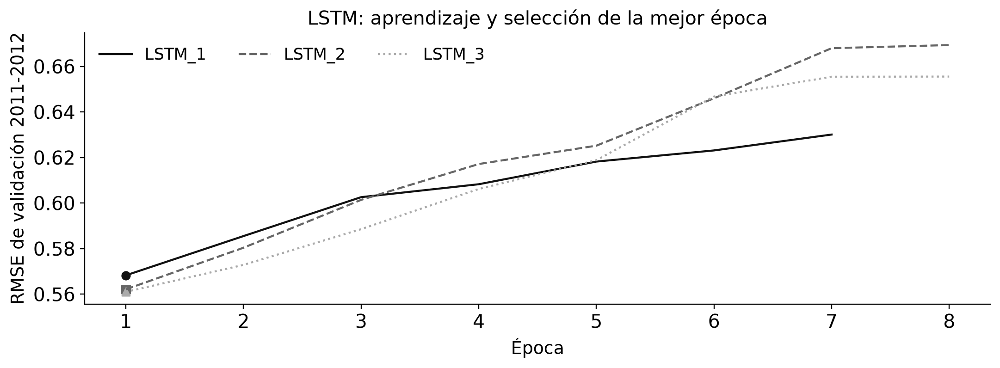

La curva permite revisar si aumentar épocas sigue mejorando validación. Se evalúa la red por su capacidad de pronóstico, sin asumir que una arquitectura más compleja deba superar a los árboles.

<!-- pagebreak -->

# 14 Ajuste y confirmación temporal

**Tabla 1. Configuraciones evaluadas en 2011-2012**

| Algoritmo | Configuración | RMSE | MAE | Ajuste en min |
| --- | --- | --- | --- | --- |
| Random Forest | RF_1 | 0.5663 | 0.4256 | 4.20 |
| Random Forest | RF_2 | 0.5680 | 0.4266 | 9.57 |
| Random Forest | RF_3 | 0.5668 | 0.4255 | 11.81 |
| XGBoost | XGB_1 | 0.5487 | 0.4134 | 0.36 |
| XGBoost | XGB_2 | 0.5492 | 0.4119 | 0.33 |
| XGBoost | XGB_3 | 0.5553 | 0.4171 | 0.27 |
| LSTM | LSTM_1 | 0.5683 | 0.4315 | 1.12 |
| LSTM | LSTM_2 | 0.5621 | 0.4246 | 1.70 |
| LSTM | LSTM_3 | 0.5610 | 0.4239 | 1.72 |

Los nueve experimentos se midieron sobre las mismas 249 667 filas de validación. Se eligió el menor RMSE de cada familia. Las diferencias de error y tiempo permiten valorar si una configuración más costosa aporta una mejora útil.

**Tabla 2. Confirmación independiente del ajuste de configuraciones en 2013**

| Algoritmo | Configuración | RMSE | MAE |
| --- | --- | --- | --- |
| Random Forest | RF_1 | 0.5430 | 0.4096 |
| XGBoost | XGB_1 | 0.5424 | 0.4096 |
| LSTM | LSTM_3 | 0.5496 | 0.4180 |

Después de ampliar entrenamiento hasta el último objetivo presente de 2012, se evaluaron 109 287 filas de 2013. XGBoost obtuvo el menor RMSE de confirmación y quedó registrado como modelo recomendado antes de la prueba final. La confirmación pertenece al desarrollo del modelo; la evidencia de generalización final se informa por separado.

<!-- pagebreak -->

# 15 Resultados de la prueba final reservada

La evaluación final incluyó 265,447 observaciones y 17 meses objetivo presentes. Los modelos se entrenaron con 1 888 574 etiquetas anteriores a enero de 2014. La máscara de prueba permaneció igual para todos.

**Tabla 3. Error fuera de muestra y referencias**

| Modelo o referencia | RMSE | MAE | R² | Sesgo |
| --- | --- | --- | --- | --- |
| Random Forest | 0.7162 | 0.5290 | 0.2837 | 0.0312 |
| XGBoost | 0.7035 | 0.5208 | 0.3088 | 0.0239 |
| LSTM | 0.6989 | 0.5186 | 0.3179 | 0.0326 |
| Persistencia causal | 0.8486 | 0.6106 | -0.0058 | 0.0434 |
| Climatología mensual | 1.1149 | 0.9349 | -0.7360 | 0.1934 |

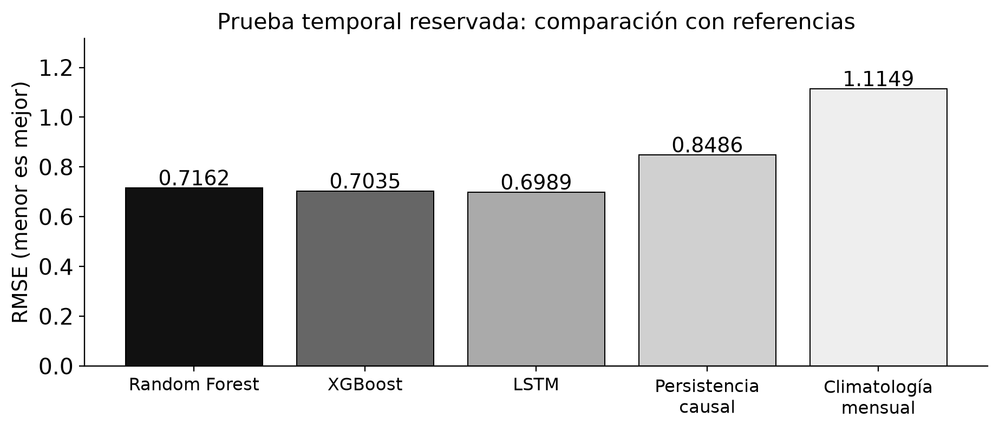

El RMSE de persistencia causal fue 0.8486. Las mejoras relativas de Random Forest, XGBoost y LSTM fueron 15.61 %, 17.10 % y 17.65 %, respectivamente. Un porcentaje negativo representaría deterioro frente a esa referencia.

La recomendación fijada en validación fue XGBoost y el menor error final descriptivo fue de LSTM. Se conservan ambas observaciones para distinguir la decisión previa de la comparación final. No se reajustó la búsqueda después de conocer estos resultados.

<!-- pagebreak -->

# 16 Eficiencia y recursos computacionales

Los experimentos se ejecutaron en un Apple M1 Pro, con ocho núcleos lógicos y 16 GB de memoria compartida. Se usaron seis hilos y CPU para las tres familias. El número de filas, la ventana de entrada y la escala del objetivo se mantuvieron comparables.

| Algoritmo | Ajuste min | ms por 1 000 filas | Modelo MB | RSS máximo MB |
| --- | --- | --- | --- | --- |
| Random Forest | 4.12 | 3.08 | 43.45 | 2329 |
| XGBoost | 0.39 | 1.13 | 0.90 | 2402 |
| LSTM | 0.31 | 2.76 | 0.09 | 2222 |

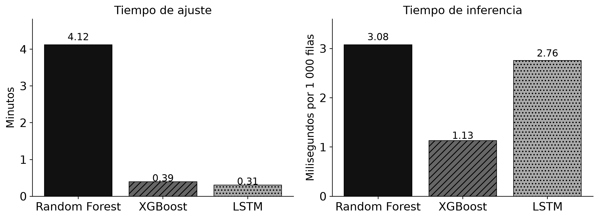

El RSS corresponde al proceso durante el ajuste e incluye matrices y estructuras auxiliares; no es una medición aislada del tamaño de los pesos. El tamaño guardado permite valorar distribución y carga. Las diferencias de biblioteca, equipo y lote pueden modificar la latencia.

La solución guarda resultados al terminar cada experimento. Si se interrumpe la ejecución, reutiliza experimentos completos y continúa con los pendientes. Los límites bootstrap del bosque, histogramas de XGBoost y lotes de la LSTM permiten trabajar con el conjunto completo sin requerir una copia separada de cada secuencia en memoria.

<!-- pagebreak -->

# 17 Comportamiento temporal y regional

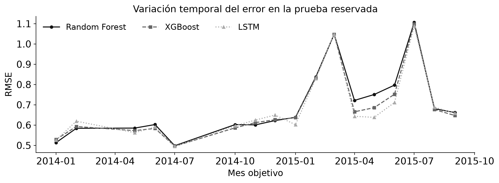

Las diferencias entre meses permiten identificar periodos difíciles y cambios en el orden de los algoritmos. Los huecos del calendario no se confunden con meses de error cero. El error global integra las observaciones individuales y puede ocultar periodos con desempeño menos favorable.

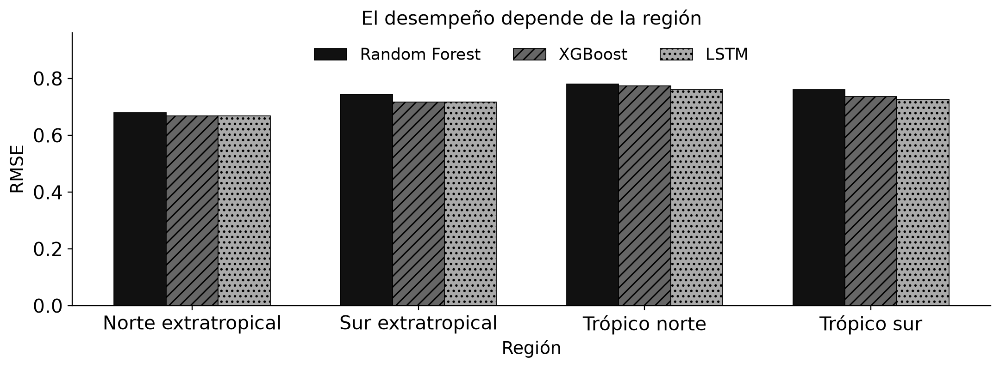

Para XGBoost, la región con mayor RMSE fue Trópico norte (0.7735) y la menor fue Norte extratropical (0.6687). Es una comparación predictiva dentro de la rejilla disponible. La cobertura desigual y las condiciones locales limitan interpretar un promedio global como una garantía territorial.

<!-- pagebreak -->

# 18 Disponibilidad e historia de TWS

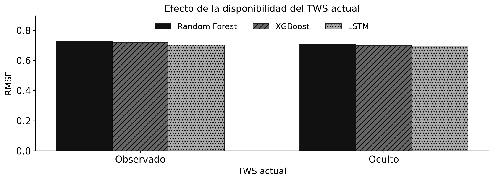

Con XGBoost, el RMSE fue 0.7175 en TWS observado y 0.6975 en TWS oculto. Estos grupos difieren también en sus fechas y condiciones hidrológicas; su diferencia de error no se interpreta como un efecto causal aislado del enmascaramiento.

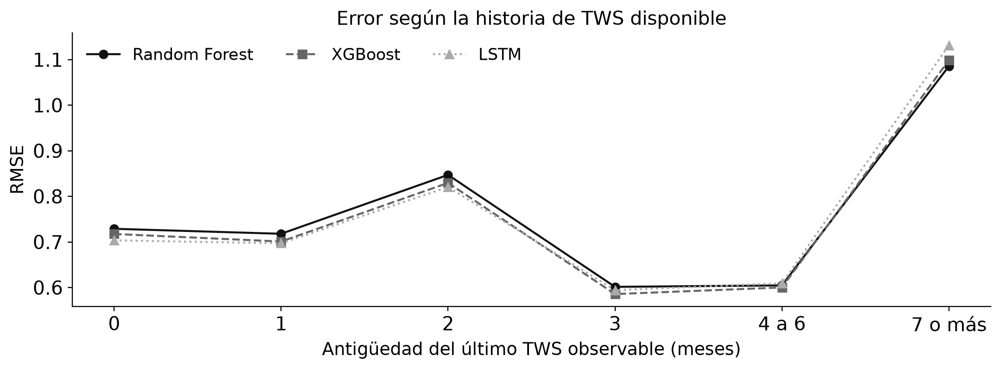

La última observación conocida y su antigüedad aportan contexto cuando faltan registros recientes. El comportamiento por antigüedad debe leerse junto con el tamaño y las fechas de cada grupo. Los casos sin historia o con antigüedad superior a la habitual pueden tener distinta representación y requieren mayor cautela al transferir la solución.

<!-- pagebreak -->

# 19 Errores y valores extremos

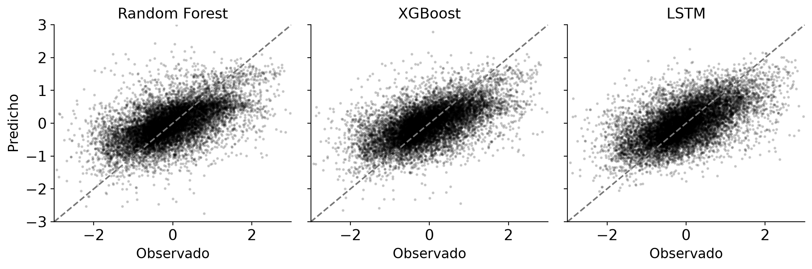

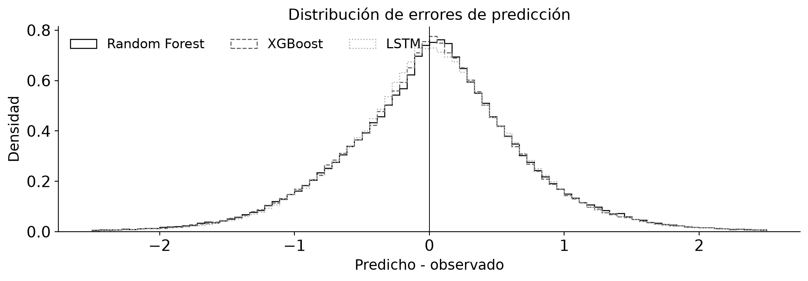

Los extremos se definieron con cortes del entrenamiento: percentil 10 = -1.0910 y percentil 90 = 1.2967. La tabla completa de errores y sesgo por extremos se conserva en metricas_extremos.csv. Esta evaluación permite detectar si una mejora media convive con atenuación de valores bajos o altos.

El sesgo medio de XGBoost fue 0.0239. Un sesgo global cercano a cero puede coexistir con errores regionales o de extremos que se compensan. Se mantiene la evaluación desglosada para no confundir calibración promedio con precisión uniforme.

<!-- pagebreak -->

# 20 Incertidumbre de la comparación e interpretación

Se realizaron 2,000 remuestreos de bloques de tres meses observados, manteniendo juntas las celdas de cada fecha. La prueba contiene 17 meses observados, una cantidad mucho menor que su número de filas. Los intervalos representan la variación de RMSE al remuestrear esos bloques.

| Algoritmo | RMSE observado | Límite 2.5 % | Límite 97.5 % |
| --- | --- | --- | --- |
| Random Forest | 0.7162 | 0.6016 | 0.8237 |
| XGBoost | 0.7035 | 0.5974 | 0.8030 |
| LSTM | 0.6989 | 0.6014 | 0.7932 |

| Diferencia de RMSE | Límite inferior | Límite superior | Incluye cero |
| --- | --- | --- | --- |
| Random Forest menos XGBoost | 0.0012 | 0.0265 | No |
| Random Forest menos LSTM | -0.0037 | 0.0428 | Sí |
| XGBoost menos LSTM | -0.0060 | 0.0163 | Sí |

Si el intervalo de una diferencia incluye cero, esta prueba no aporta evidencia temporal suficiente para sostener un orden estable entre esas dos familias. Si lo excluye, la conclusión sigue condicionada al calendario, a las máscaras y al esquema de bloques utilizados. No se interpreta como garantía para todos los años futuros.

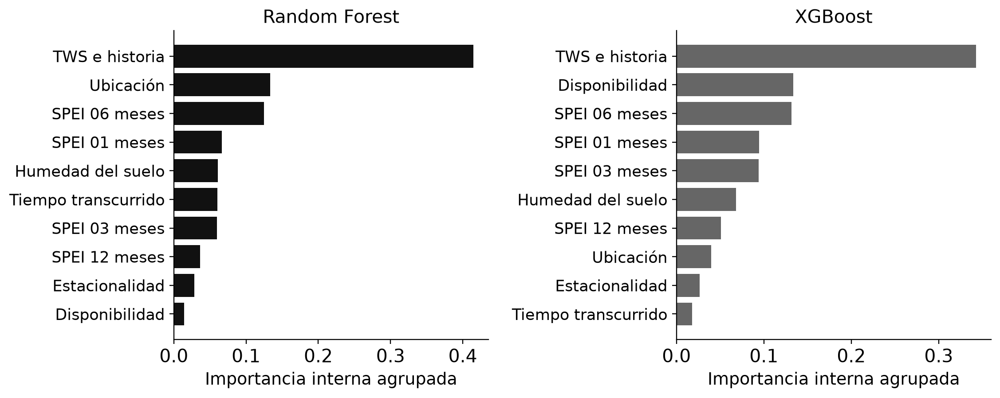

<!-- pagebreak -->

# 21 Aplicación para explorar los datos

La aplicación se construyó con Streamlit y Plotly, utilizando sus componentes interactivos y herramientas de prueba (Streamlit, s. f.; Plotly, s. f.). Organiza el recorrido en tres pestañas: Explorar datos, Pronosticar y Evaluar modelos. La barra lateral permite elegir Todos, Random Forest, XGBoost o LSTM. El usuario puede ocultar las gráficas y métricas de rendimiento sin perder el resto de funciones.

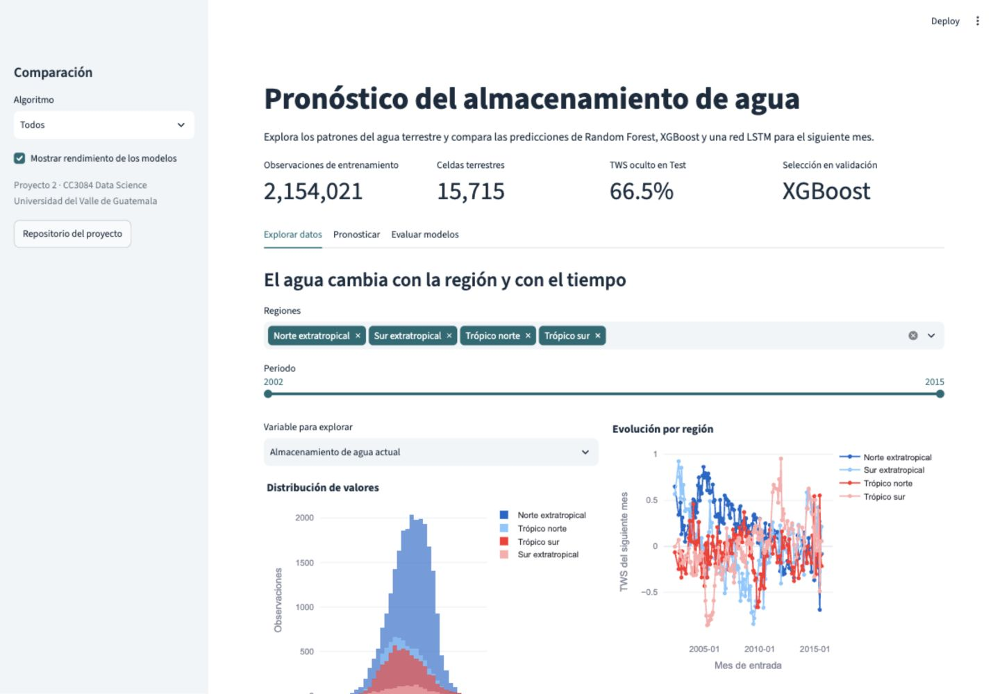

La exploración incluye filtros de región y periodo, distribución de una variable seleccionable, evolución temporal regional, distribución espacial y descripción de columnas. La distribución utiliza una muestra reproducible de 40 000 filas para facilitar navegación; las series y el mapa resumen todos los datos de entrenamiento. Esa reducción visual no se utiliza para calcular métricas.

La paleta de la aplicación utiliza fondo claro, texto oscuro y acentos azul verdosos relacionados con el agua. Los algoritmos mantienen colores consistentes en las gráficas. Los rótulos, leyendas y controles complementan el color para que la interpretación no dependa exclusivamente de distinguir tonalidades.

<!-- pagebreak -->

# 22 Aplicación para pronosticar nuevas observaciones

El formulario solicita mes, coordenadas, SPEI en cuatro escalas y humedad del suelo. Un control permite indicar si se conoce el TWS actual. También se puede cargar un ejemplo real de Test. La aplicación identifica historia observable para esa celda y prepara automáticamente las mismas 57 entradas que utiliza el entrenamiento.

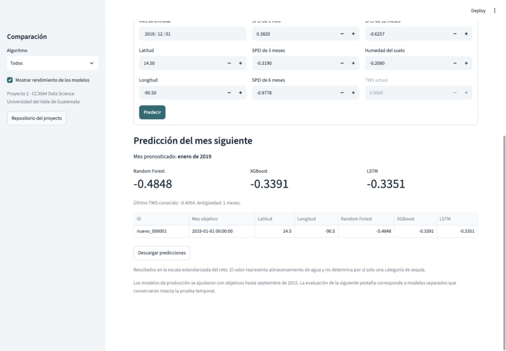

La alternativa CSV acepta hasta 300 000 observaciones y permite descargar una plantilla. TWS_t es opcional y las otras covariables son necesarias. Las filas anteriores del archivo pueden aportar historia, siempre respetando su fecha. Se rechazan fechas inválidas, duplicados de celda-mes, coordenadas fuera de rango, valores infinitos y covariables no numéricas.

El resultado muestra el mes objetivo y la predicción de cada algoritmo elegido, conserva la escala estandarizada y permite descargar las filas completas. Para un registro individual también informa la última observación de TWS y su antigüedad, cuando existe. El sistema pronostica una cantidad de agua estandarizada; no convierte ese número automáticamente en una categoría de sequía.

<!-- pagebreak -->

# 23 Aplicación para evaluar los algoritmos

La pestaña de evaluación muestra RMSE, MAE, R², sesgo y tiempos de cada modelo seleccionado. Las gráficas interactivas comparan error global, evolución mensual, regiones, disponibilidad de TWS, dispersión y promedio global observado frente a pronosticado. Se puede inspeccionar un algoritmo o ver los tres.

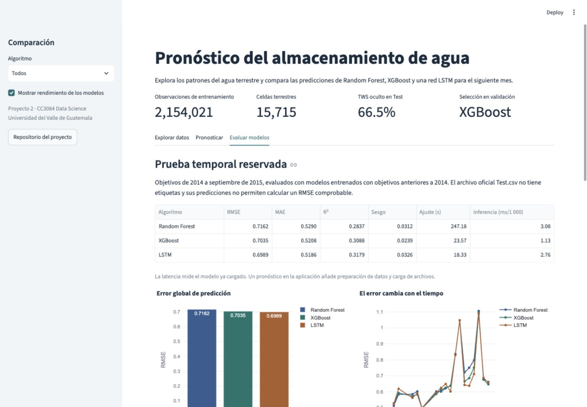

Las métricas provienen de predicciones fuera de muestra guardadas antes del reajuste de producción. Esa separación evita mostrar como prueba el ajuste de un modelo que ya vio esas etiquetas. El archivo Test oficial se utiliza únicamente para emitir pronósticos sin atribuirle precisión no verificable.

Se probó el recorrido de formulario y carga CSV, la selección de uno y todos los modelos, el manejo de TWS ausente, entradas inválidas, descargas y el control para ocultar rendimiento. Las pruebas de integración verifican que las predicciones sean finitas y que guardar y recargar los modelos conserve sus salidas.

<!-- pagebreak -->

# 24 Discusión y conclusiones

El objetivo de construir y comparar tres familias se cumplió con nueve configuraciones de ajuste, confirmación temporal y prueba reservada. XGBoost quedó seleccionado con validación de 2013; su RMSE final fue 0.7035. El resultado se compara con persistencia causal bajo las mismas filas y máscaras, y no con el valor descriptivo de la etapa exploratoria.

La LSTM obtuvo el menor RMSE descriptivo final (0.6989), frente a 0.7035 de XGBoost. Sin embargo, el intervalo de la diferencia XGBoost menos LSTM fue de -0.0060 a 0.0163 e incluye cero. Esa diferencia no demuestra una superioridad temporal estable; se mantiene la recomendación fijada antes de la prueba.

La preparación incorporó calendario, faltantes e historia sin usar observaciones futuras. Los resultados desglosados muestran que una decisión basada solo en error global resulta incompleta: las condiciones de disponibilidad, región y extremos forman parte del desempeño práctico. Los intervalos por bloques añaden una lectura de incertidumbre acorde con la dependencia temporal.

La aplicación integra exploración y pronóstico con el mismo preprocesamiento del entrenamiento. Permite trabajar con TWS oculto y comparar modelos sin requerir que el usuario construya rezagos o ajuste escaladores. Las gráficas pueden ocultarse y las predicciones se descargan para continuar el análisis.

La evaluación tiene límites concretos. La prueba reservada cubre un número reducido de meses observados y la máscara es una simulación aproximada. La composición espacial favorece el hemisferio norte. Test abarca años posteriores y un calendario más discontinuo. Los modelos no se validaron reservando regiones enteras y no se dispone de etiquetas de Test para verificar precisión en ese periodo.

Las importancias de árboles describen asociaciones predictivas internas. Los valores estandarizados no proporcionan volumen físico ni un umbral universal de sequía. Las predicciones no incluyen intervalos de incertidumbre por observación; los intervalos presentados corresponden a la comparación agregada de errores.

La siguiente evaluación útil consiste en incorporar nuevos meses etiquetados, contrastar varias máscaras temporales y reservar regiones completas antes de ampliar el uso geográfico. Esas ampliaciones deben conservar el corte temporal y compararse con las mismas referencias. El resultado actual entrega una solución ejecutada, documentada y reutilizable, con sus condiciones de validez explícitas.

<!-- pagebreak -->

# 25 Herramientas y reproducción

Se utilizó Python 3.12.14, NumPy 2.3.5, pandas 2.2.3, scikit-learn 1.9.1, XGBoost 3.4.1 y PyTorch 2.14.1. La aplicación utiliza Streamlit 1.65.0 y Plotly 7.1.0. Las versiones exactas, semillas, parámetros y huellas SHA-256 están guardadas en los manifiestos de la entrega.

Los datos originales se descargan desde Zindi y se colocan en data/raw/. Los productos preparados se guardan en data/processed/modelado/, los pesos en models/, los resultados en outputs/modelado/ y las figuras en figures/resultados/. El notebook de resultados permite inspeccionar los experimentos ya ejecutados y volver a generar el análisis.

## Ejecución desde la raíz del repositorio

```text
python -m pip install -r requirements-modelado.lock.txt
python scripts/entrenar_modelos.py --stage all --family all
python scripts/analizar_resultados.py
python scripts/generar_notebook_resultados.py
python -m streamlit run app.py
```

El entrenamiento respeta el orden Random Forest, XGBoost y LSTM. Guarda checkpoints por experimento y puede reanudarse. El proceso genera predicciones con las columnas ID y Target para todas las filas de Test, además de un archivo correspondiente a la familia recomendada. No realiza una entrega automática a la plataforma.

El código del proyecto utiliza bibliotecas abiertas. La carpeta de entrega incluye la aplicación, instrucciones, modelos entrenados, métricas, figuras, notebook e informe editable. La presentación conserva tablas y gráficas de resultados editables.

[Repositorio usado para versionar el código](https://github.com/Javiervalladares1/CC3084-Proyecto2-Drought-EDA)

<!-- pagebreak -->

# Referencias científicas

## APA séptima edición

Breiman, L. (2001). Random forests. *Machine Learning, 45*(1), 5-32. [https://doi.org/10.1023/A:1010933404324](https://doi.org/10.1023/A:1010933404324)

Hochreiter, S., & Schmidhuber, J. (1997). Long short-term memory. *Neural Computation, 9*(8), 1735-1780. [https://doi.org/10.1162/neco.1997.9.8.1735](https://doi.org/10.1162/neco.1997.9.8.1735)

Li, F., & Kusche, J. (2026). Observation-driven forecast of global terrestrial water storage and evaluation for 2010-2024. *Water Resources Research, 62*(2), e2025WR041710. [https://doi.org/10.1029/2025WR041710](https://doi.org/10.1029/2025WR041710)

Long, D., Shen, Y., Sun, A., Hong, Y., Longuevergne, L., Yang, Y., Li, B., & Chen, L. (2014). Drought and flood monitoring for a large karst plateau in Southwest China using extended GRACE data. *Remote Sensing of Environment, 155*, 145-160. [https://doi.org/10.1016/j.rse.2014.08.006](https://doi.org/10.1016/j.rse.2014.08.006)

Lu, S., Li, W., Yao, G., Zhong, Y., Bao, L., Wang, Z., Bi, J., Zhu, C., & Guo, Q. (2024). The changes prediction on terrestrial water storage in typical regions of China based on neural networks and satellite gravity data. *Scientific Reports, 14*, Artículo 16855. [https://doi.org/10.1038/s41598-024-67611-8](https://doi.org/10.1038/s41598-024-67611-8)

<!-- pagebreak -->

# Referencias científicas continuación

Mo, S., Zhong, Y., Forootan, E., Mehrnegar, N., Yin, X., Wu, J., Feng, W., & Shi, X. (2022). Bayesian convolutional neural networks for predicting the terrestrial water storage anomalies during GRACE and GRACE-FO gap. *Journal of Hydrology, 604*, Artículo 127244. [https://doi.org/10.1016/j.jhydrol.2021.127244](https://doi.org/10.1016/j.jhydrol.2021.127244)

Palazzoli, I., Ceola, S., & Gentine, P. (2025). GRAiCE: Reconstructing terrestrial water storage anomalies with recurrent neural networks. *Scientific Data, 12*, Artículo 146. [https://doi.org/10.1038/s41597-025-04403-3](https://doi.org/10.1038/s41597-025-04403-3)

Roberts, D. R., Bahn, V., Ciuti, S., Boyce, M. S., Elith, J., Guillera-Arroita, G., Hauenstein, S., Lahoz-Monfort, J. J., Schröder, B., Thuiller, W., Warton, D. I., Wintle, B. A., Hartig, F., & Dormann, C. F. (2017). Cross-validation strategies for data with temporal, spatial, hierarchical, or phylogenetic structure. *Ecography, 40*(8), 913-929. [https://doi.org/10.1111/ecog.02881](https://doi.org/10.1111/ecog.02881)

Sun, A. Y., Scanlon, B. R., Save, H., & Rateb, A. (2021). Reconstruction of GRACE total water storage through automated machine learning. *Water Resources Research, 57*(2), e2020WR028666. [https://doi.org/10.1029/2020WR028666](https://doi.org/10.1029/2020WR028666)

Sun, Z., Long, D., Yang, W., Li, X., & Pan, Y. (2020). Reconstruction of GRACE data on changes in total water storage over the global land surface and 60 basins. *Water Resources Research, 56*(4), e2019WR026250. [https://doi.org/10.1029/2019WR026250](https://doi.org/10.1029/2019WR026250)

Vicente-Serrano, S. M., Beguería, S., & López-Moreno, J. I. (2010). A multiscalar drought index sensitive to global warming: The standardized precipitation evapotranspiration index. *Journal of Climate, 23*(7), 1696-1718. [https://doi.org/10.1175/2009JCLI2909.1](https://doi.org/10.1175/2009JCLI2909.1)

<!-- pagebreak -->

# Fuentes de documentación y del proyecto

NASA/JPL. (s. f.). *Measuring water storage in the Amazon*. GRACE Tellus. [https://grace.jpl.nasa.gov/resources/8/measuring-water-storage-in-the-amazon/](https://grace.jpl.nasa.gov/resources/8/measuring-water-storage-in-the-amazon/)

*Proyecto 2: Análisis exploratorio*. (2026). [Informe de curso no publicado]. Universidad del Valle de Guatemala. [Repositorio del proyecto](https://github.com/Javiervalladares1/CC3084-Proyecto2-Drought-EDA)

Plotly. (s. f.). *Open source Python graphing and data visualization library*. [https://plotly.com/python/](https://plotly.com/python/)

PyTorch Contributors. (s. f.). *LSTM*. PyTorch documentation. [https://docs.pytorch.org/docs/stable/generated/torch.nn.LSTM.html](https://docs.pytorch.org/docs/stable/generated/torch.nn.LSTM.html)

scikit-learn Developers. (s. f.). *RandomForestRegressor*. scikit-learn documentation. [https://scikit-learn.org/stable/modules/generated/sklearn.ensemble.RandomForestRegressor.html](https://scikit-learn.org/stable/modules/generated/sklearn.ensemble.RandomForestRegressor.html)

Streamlit. (s. f.). *App testing*. Streamlit documentation. [https://docs.streamlit.io/develop/api-reference/app-testing](https://docs.streamlit.io/develop/api-reference/app-testing)

Universidad del Valle de Guatemala. (2026). *Guía del Proyecto 2: Resultados*. [Material del curso CC3084 Data Science]. Facultad de Ingeniería.

XGBoost Developers. (s. f.). *Python API reference*. XGBoost documentation. [https://xgboost.readthedocs.io/en/stable/python/python_api.html](https://xgboost.readthedocs.io/en/stable/python/python_api.html)

Zindi. (s. f.). *A step ahead of drought: Forecasting global water storage challenge by ITU*. Recuperado el 13 de octubre de 2026, de [https://zindi.world/competitions/one-step-ahead-of-drought-forecasting-global-water-storage-challenge](https://zindi.world/competitions/one-step-ahead-of-drought-forecasting-global-water-storage-challenge)

<!-- pagebreak -->

# Anexo de procedencia bibliográfica

Los antecedentes aplicados se publicaron en revistas indexadas. La siguiente evidencia pública documenta las siete revistas del corpus inicial. Se informa cobertura editorial sin asignar cuartiles ni factores de impacto. Las fuentes técnicas y los materiales del curso se distinguen de los artículos científicos.

| Revista | Artículos incluidos | Índice documentado | Fuente de verificación |
| --- | --- | --- | --- |
| Remote Sensing of Environment | Long et al. (2014) | Scopus | [Registro institucional de los autores, con enlace al artículo en Scopus](https://researchnow.flinders.edu.au/en/publications/drought-and-flood-monitoring-for-a-large-karst-plateau-in-southwe/) |
| Water Resources Research | Z. Sun et al. (2020); A. Y. Sun et al. (2021); Li y Kusche (2026) | Scopus y SCIE | [AGU/Wiley: alcance e indexación](https://agupubs.onlinelibrary.wiley.com/hub/journal/19447973/aims-and-scope/read-full-aims-and-scope) |
| Journal of Hydrology | Mo et al. (2022) | Scopus y Web of Science | [Centro Internacional del ISSN: 0022-1694](https://portal.issn.org/custom-search/print/0022-1694/public) |
| Scientific Reports | Lu et al. (2024) | Scopus y Web of Science | [Nature Portfolio: información de la revista](https://www.nature.com/srep/about) |
| Scientific Data | Palazzoli et al. (2025) | Scopus y Web of Science | [Centro Internacional del ISSN: 2052-4463](https://portal.issn.org/resource/ISSN/2052-4463) |
| Machine Learning | Breiman (2001) | Scopus y SCIE | [Springer Nature: abstracting and indexing](https://link.springer.com/journal/10994) |
| Ecography | Roberts et al. (2017) | Scopus y Web of Science | [Centro Internacional del ISSN: 1600-0587](https://portal.issn.org/resource/ISSN/1600-0587) |

Neural Computation, que publica el fundamento de LSTM, documenta Scopus, Science Citation Index Expanded y Web of Science en su [lista editorial de indexación](https://direct.mit.edu/neco/pages/abstracting-indexing). La referencia original de SPEI se verificó en la [página editorial de Journal of Climate](https://journals.ametsoc.org/view/journals/clim/23/7/2009jcli2909.1.xml).

Los títulos, autores, años, volúmenes, páginas o localizadores y DOI de los antecedentes se contrastaron con páginas editoriales, Crossref o registros institucionales. Para obras de acceso limitado se consultó el resumen disponible sin atribuir métodos no accesibles. Las cifras propias se generan mediante los scripts y se conservan en tablas de resultados.
